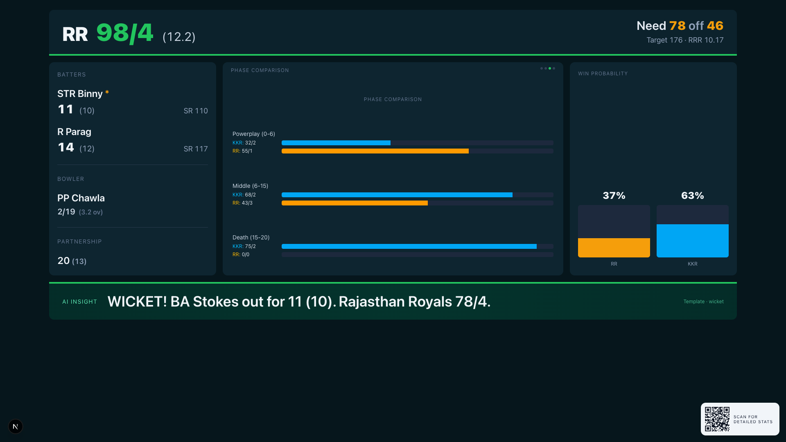

\newpage

BITS Pilani · Introduction to Sports Engineering · Semester I, 2026–27

Spectator Display Board

Real-time statistics, player comparisons, performance trends and AI-based insights for cricket spectators — built on a replay engine and evaluated for glanceable usability.

<strong>Assignment brief #15 —</strong> Develop a display board that uses game data to generate real-time statistics, player/team comparisons, performance trends and AI-based insights for spectators; evaluate its usability and on-field audience engagement.

Team

[Student 1 Name] — [ID 1] 
[Student 2 Name] — [ID 2]

Targeted focus

<strong>Primary:</strong> Organisers · Spectators 
<strong>Secondary:</strong> Sport technologists

Submission

[ID1]_[ID2]_SE_Assignment2.pdf 
<a href="https://github.com/Rohit-209/spectator-display-board">github.com/Rohit-209/spectator-display-board</a>

1,243 / 1,243

IPL matches pass the stats-engine correctness harness

6 ms / 12 ms

end-to-end latency: p50 / p95 — plan target ≤ 300 ms / 1 s

0.139 Brier

win-prob model vs 0.148 RRR-only baseline (held-out seasons 2025 + 2026)

<figure class="cover-hero">

<figcaption>The board mid-chase: Rajasthan Royals 98/4 (12.2) chasing 176 vs Kolkata Knight Riders · IPL 2019, Eden Gardens.</figcaption>
</figure>

